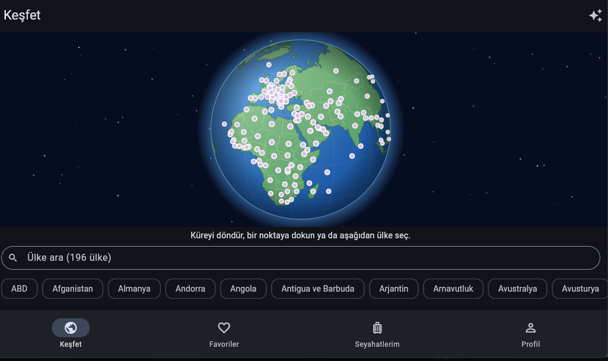
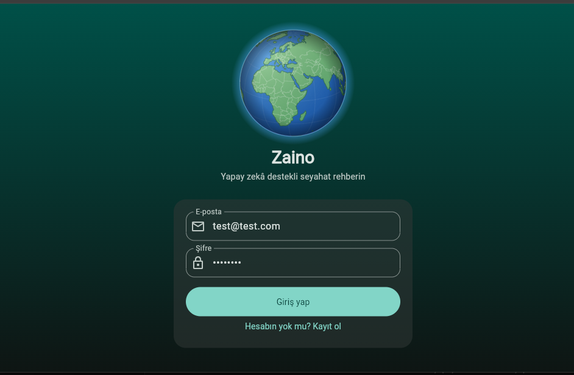
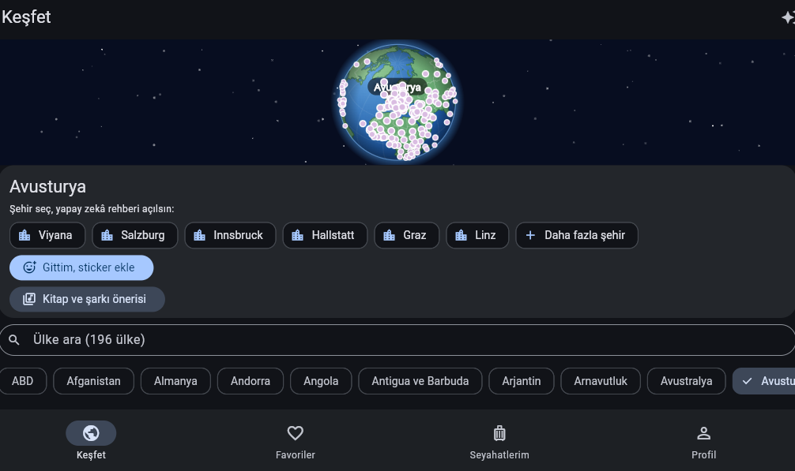
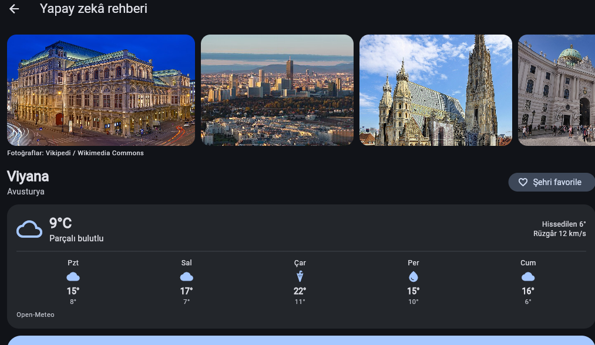
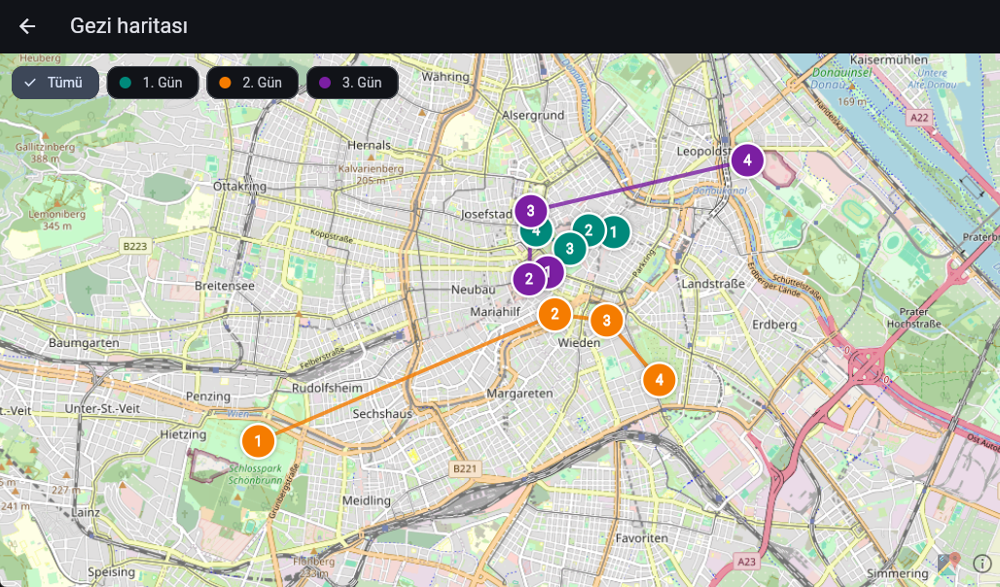
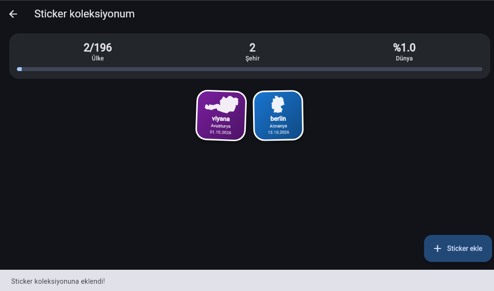
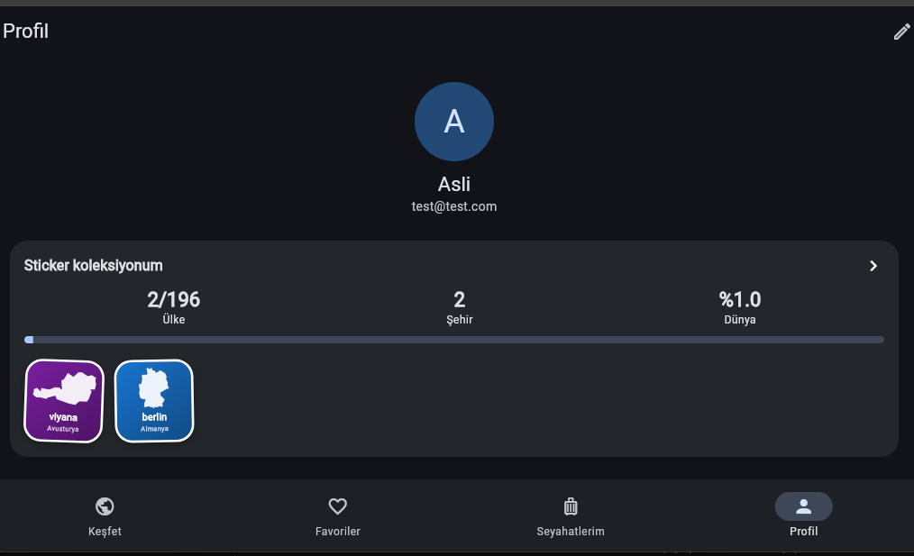

# 🎒 Zaino

An AI-powered travel guide: spin a 3D globe, pick any of 196 countries, get an AI city guide with photos and weather, plan trips on a map, and collect a sticker for every place you have been.

**Stack:** Java 21 · Spring Boot 4 · Spring Security (JWT) · Spring Data JPA · PostgreSQL 16 · Flyway · Docker · Flutter



## Features

**Mobile / web app (Flutter)**
- Interactive 3D globe (custom orthographic projection, drawn with `CustomPainter`) with all 196 countries, country borders and highlighting, zoom and search
- Cities per country, plus "more cities" generated on demand
- AI city guide: overview, must-see places, what to eat, tips. Every line can be favorited or added to a trip
- City photos (Wikipedia / Wikimedia Commons) and a 5-day weather forecast (Open-Meteo)
- AI trip planner: pick a city, days and interests, get a day-by-day plan saved as a trip
- Trip map (OpenStreetMap): stops numbered and colored per day, route lines, day filter
- Share a trip via WhatsApp, e-mail or clipboard
- Book and song recommendation for every country
- Sticker collection: collect a sticker (country silhouette) for each place you visited; visited countries light up on the globe; progress stats
- Profile: display name, short bio, accent color that themes the whole app
- Turkish / English UI, including country and city names and AI answers
- Light and dark theme

**Backend (Spring Boot)**
- Register / login with BCrypt-hashed passwords and JWT access tokens
- Trips with days and ordered stops (add, move, delete), favorites, stickers, profile
- AI endpoint that proxies prompts to the Anthropic API (the key never reaches the client)
- Schema versioned with Flyway migrations
- Unit tests with JUnit 5 and Mockito

## Screenshots

| Login | Globe | Country card |
|---|---|---|
|  |  |  |

| City guide | Trip plan | Trip map |
|---|---|---|
|  |  |  |

| Sticker collection | Profile |
|---|---|
|  |  |

## Architecture

```
Flutter app ──HTTP/JSON + JWT──▶ Spring Boot API ──JPA──▶ PostgreSQL
     │                                  │
     ├─ Open-Meteo (weather)            └─ Anthropic API (AI guides, plans)
     ├─ Wikipedia (photos)
     └─ OpenStreetMap / Nominatim (map, geocoding)
```

Backend packages: `auth`, `user`, `profile`, `trip`, `favorite`, `sticker`, `ai`, plus security configuration. Each feature has a controller, service, repository and DTO records; controllers read the user id from the JWT subject, so a user can only access their own data.

### Main endpoints

| Method | Path | Description |
|---|---|---|
| POST | `/api/auth/register`, `/api/auth/login` | Create account, get a JWT |
| GET / PUT | `/api/profile` | Read / update display name, bio, accent color |
| GET / POST | `/api/trips` | List / create trips |
| GET / DELETE | `/api/trips/{id}` | Trip with days and stops / delete |
| POST | `/api/trips/{id}/stops` | Add a stop |
| PUT / DELETE | `/api/trips/{id}/stops/{stopId}` | Move (`/move`) / delete a stop |
| GET / POST / DELETE | `/api/favorites` | Favorite places, foods, cities |
| GET / POST / DELETE | `/api/stickers` | Sticker collection (one per user, country and city) |
| POST | `/api/ai` | Send a prompt to the AI model |

## Running locally

**Requirements:** Java 21, Docker, Flutter 3.x and an Anthropic API key (only needed for the AI features).

**1. Database**
```bash
docker compose up -d
```
PostgreSQL 16 starts on port `5433`. Flyway creates the schema when the backend starts.

**2. Backend**
```bash
export ANTHROPIC_API_KEY=your-key      # PowerShell: $env:ANTHROPIC_API_KEY="your-key"
./mvnw spring-boot:run
```
The API listens on `http://localhost:8080`. Health check: `http://localhost:8080/actuator/health`.

**3. App**
```bash
cd app
flutter pub get
flutter run -d chrome
```
On the Android emulator the app reaches the backend at `http://10.0.2.2:8080`.

## Tests

```bash
./mvnw test
```

24 unit tests cover the service layer: authentication (including Turkish-locale e-mail normalization), trips and stops, stickers (duplicate detection, ownership checks) and profile updates.

## Roadmap

- [ ] Deploy the backend over HTTPS
- [ ] Android release on Google Play (closed test first)
- [ ] iOS build
- [ ] Persist the language choice on the device
- [ ] Integration tests with Testcontainers

## Notes

Map data © OpenStreetMap contributors. Photos from Wikipedia / Wikimedia Commons under their respective licenses. Weather data from Open-Meteo.
